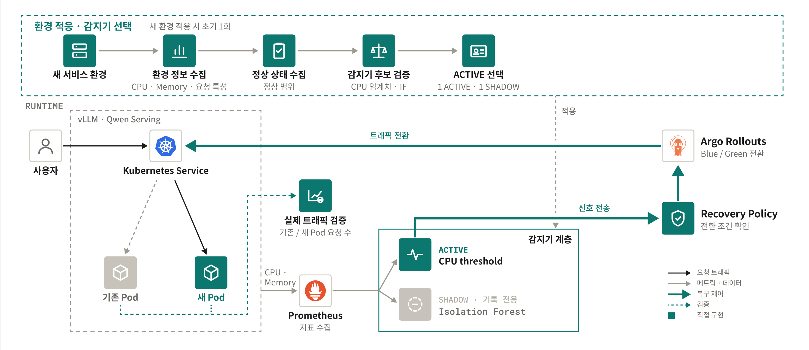

# LLMOps 기반 응답 저하 자동 전환 시스템

**쿠버네티스 LLM 서비스의 응답 저하를 감지해, 새 요청을 준비된 예비 Pod로 자동 전환하고 실제 요청 이동과 사용자 지연 감소까지 확인하는 시스템**

2026 숭실대학교 전자정보공학부 IT융합전공 졸업작품 · 지도교수 김영한 교수님 · 작성자 박소정

---

## 왜 필요한가?

Kubernetes는 Pod가 살아 있는지는 관리하지만, Pod가 정상으로 보이는 동안에도 LLM 응답은 느려질 수 있습니다. 상태 확인(readiness probe)은 서버가 **아예 대답을 못 할 때**만 Pod를 빼고, 느리게라도 대답하면 정상으로 봅니다. **Pod가 정상이라는 것과 사용자가 정상 품질을 받는 것은 같지 않습니다.**

> **서비스는 살아 있지만 느려진 상황을 감지하고, 잘못된 전환 없이 새 요청을 건강한 Pod로 옮길 수 있는가?**

## 시스템 구조

  

1. **감지(Detect)** - 15초마다 최근 60초 지표를 평가하고, 3번 연속 이상이면 신호를 보냅니다. 장애 유형마다 사전 등록 규칙으로 고른 감지기를 씁니다: CPU 압박은 **CPU 임계값 규칙**, 네트워크 지연은 **상태 확인 규칙**(readiness probe 소요 시간, `net_probe`). Isolation Forest는 **SHADOW(기록만)** 입니다.
2. **확인(Guard)** - 신호가 와도 바로 전환하지 않습니다. 신호 시점의 대상과 지금 상태(active/preview 버전, Pod UID, 종료 여부, 예비 Pod Ready)가 같을 때만 진행합니다.
3. **전환(Promote)** - Argo Rollouts에 Blue/Green 승격을 1번 요청해 Service가 예비 Pod를 가리키게 합니다. 승격은 Argo의 기능이고, **언제 승격해도 되는지 판단하고 결과를 확인하는 Recovery Policy**가 이 프로젝트의 구현입니다.
4. **검증(Verify)** - 승격 API 성공만 믿지 않고, 기존·새 Pod의 요청 카운터로 실제 요청 이동을 확인합니다(예: 새 Pod +60, 기존 +0).

## 핵심 결과 - 통일 비교 (2026-11-06)

장애 3종 × 비교 방식 4개를 **같은 규칙으로 칸마다 유효 10회** 반복했습니다. 값은 주입 후 10분 동안 품질 기준(60초 P95 > 0.648초가 30초 이상 지속, 또는 성공률 < 99%)을 어긴 시간의 합(초), 중앙값(최소~최대)입니다.

| 장애 | 무전환 | 오토스케일링 | 계속 분산 | 우리 시스템 |
|---|---|---|---|---|
| CPU 압박 | 269.7 (200.5~292.5) | 232.9 (191.5~291.8) | 247.0 (192.0~291.8) | **0.0** (10회 모두 0) |
| 네트워크 지연 | 389.1 (387.9~391.0) | 388.5 (378.9~393.0) | 386.6 (372.9~390.1) | **92.0** (47.1~129.1) |
| 요청 폭주 | 310.3 (131.6~475.0) | 267.8 (198.8~392.1) | 287.8 (84.4~339.0) | **365.5** (303.7~474.0) |

- **특정 Pod가 느려질 때(CPU 압박·네트워크 지연):** 새 요청을 예비 Pod로 옮긴 우리 시스템이 가장 짧았고, 다른 세 방식과 범위가 겹치지 않았습니다.
- **요청이 몰릴 때(요청 폭주):** 우리 시스템이 **가장 길었습니다.** 같은 크기의 Pod로 바꿀 뿐 용량이 늘지 않기 때문으로 보이며(추정), 이 상황에는 확장이 맞습니다.
- **요청 이동:** 우리 시스템 유효 30회 모두 전환 뒤 새 Pod +60, 기존 Pod +0으로 확인됐습니다.

무효 16회, 재시도·보충, 네트워크 지연 결과에 영향을 준 3회 등 함께 밝혀야 할 점은 → [통일 비교 최종 결과](docs/final/UNIFIED-COMPARISON-RESULT-20261106.md)

### 그 밖의 검증

| 검증 | 결과 | 문서 |
|---|---|---|
| 장애 유형별 감지기 선택 | CPU 압박: CPU 임계값 5/5 · IF 0/5 → 실제 복구 3/3 네트워크 지연: 상태 확인 규칙 5/5 (CPU 임계값 0/5) → 실제 복구 3/3 | [Phase 2](docs/final/PHASE2-FINAL-RESULT-20261012.md) · [네트워크 지연](docs/final/NETWORK-ENV-VALIDATION-20261019.md) |
| 전환 뒤 요청별 추적 (네트워크 지연, 1쌍) | 전환 뒤 새 연결 요청 552건 모두 새 Pod 처리, 기존 Pod 0건 | [요청 단위 보호](experiments/results/hpa_compare/analysis/RESULT-SUMMARY-PER-REQUEST-DRAIN-20261023.md) |
| 진행 중이던 답변 | 종료 대기(`--shutdown-timeout 90`)로 4건 중 완료 1 → 3 | 같은 문서 |
| 정상 운전 불필요 신호 (IF 재학습) | 14 → 1 | [연구 정리](docs/final/FINAL-RESEARCH-SYNTHESIS-20261011.md) |
| 초기 CPU 압박 A/B (IF c1 감지기) | 공식 5쌍 + 추가 3쌍 모두 자동 전환 쪽 0초 | [추가 반복](docs/final/PHASE1-AB-ADDITIONAL-REPLICATION-20261013.md) |

## 한계

- 클러스터 1개, CPU 기반 vLLM(Qwen2.5-0.5B), Pod 2개 규모에서만 검증했습니다. GPU·다른 모델·대규모 환경은 확인하지 않았습니다.
- 네트워크 장애는 지연(지터 포함)만 넣었고, 상태 확인 규칙은 넣은 지연을 거의 직접 재는 값입니다. **AI·다변량 감지가 더 낫다는 근거로 쓰지 않습니다.**
- 감지기는 원인을 구분하지 않아 요청 폭주에서도 전환합니다. 확장과 전환을 함께 쓰는 판단은 다음 과제입니다.
- 장애 주입부터 전환까지 33~165초가 걸려, 그 전의 저하는 막지 못합니다.
- 전환 뒤 예비 Pod를 자동으로 다시 만들지 않습니다. 연결을 재사용하는(keepalive) 요청은 전환 뒤에도 잠시 기존 Pod로 갈 수 있습니다.
- clone만으로 모든 실험을 재현할 수는 없습니다([재현성 범위](docs/README.md#재현성-범위)).

## 저장소 구성

| 폴더 | 내용 |
|---|---|
| [recovery-policy/](recovery-policy/README.md) | **Recovery Policy** - 신호 수신(`main_guarded.py`), 전환 판단(`guarded_policy.py`), 승격·검증(`guarded_k8s.py`) |
| [anomaly-detection/](anomaly-detection/README.md) | 감지기 규칙·특징 계산·Isolation Forest 모델 메타데이터 |
| [gitops/](gitops/README.md) | Argo Rollout, Service, RBAC, Recovery Policy 배포 매니페스트 |
| [chaos/](chaos/) | 장애 주입 정의(Chaos Mesh, 요청 폭주 시나리오) |
| [experiments/](experiments/README.md) | 공식 실험 실행기·분석기·결과 근거 (통일 비교는 `experiments/hpa_compare/`) |
| [docs/](docs/README.md) | 최종 결과(`final/`), 사전 등록(`design/`), 발표 자료(`presentation/`), 시연(`demo/`) |
| [demo/](demo/README.md) · [dashboard/](dashboard/README.md) | 발표 시연 스크립트와 읽기 전용 시연 화면(공식 결과 아님) |
| [audit-log/](audit-log/) | Recovery Policy 감사 기록 |

**이 프로젝트의 핵심은 특정 AI 모델의 우월성이 아니라, 장애 유형에 맞는 감지기를 고르고 안전한 전환 경로에 연결해 실제 요청 이동과 사용자 지연 감소까지 확인한 것입니다. 그리고 그 방법이 맞지 않는 상황(요청 폭주)도 같은 규칙으로 확인했습니다.**
