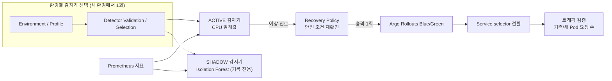

<div align="center">

# Kubernetes LLM 서빙 환경의 이상 탐지 및 자동 복구

**운영 환경에 맞는 감지기를 선택하고, 이상 신호가 오면 안전 조건을 확인한 뒤<br>Blue/Green 전환과 실제 트래픽 이동까지 검증하는 Kubernetes 기반 자동 복구 시스템**


[](docs/final/PHASE2-FINAL-RESULT-20261012.md)
[](demo/README.md)
[](experiments/README.md)

<sub>2026 숭실대학교 전자정보공학부 IT융합전공 졸업작품 · 지도교수 김영한 교수님 · 작성자 박소정</sub>

</div>

---

## 왜 이 프로젝트가 필요한가?

Kubernetes는 Pod·Container 상태와 선언된 Desired State를 관리하지만, Pod가 정상 상태인 동안에도 실제 LLM 응답 성능은 부하에 따라 저하될 수 있습니다.

즉, **Pod가 정상이라는 것과 사용자가 정상적인 서비스 품질을 받고 있다는 것은 같지 않습니다.**

이 프로젝트는 이 차이를 운영 메트릭으로 관찰하고, 이상 신호가 발생했을 때 안전 조건을 다시 확인한 뒤 준비된 새 Pod로 트래픽을 전환하고, 실제 요청이 이동했는지까지 검증하는 자동 복구 흐름을 구현했습니다.

## 해결하려는 문제

> **서비스가 살아 있지만 느려진 상황을 어떻게 감지하고,
> 잘못된 전환 없이 실제 서비스 복구까지 확인할 것인가?**

이를 위해 세 가지를 풀었습니다.

| 질문 | 이 프로젝트의 답 |
|---|---|
| 무엇으로 감지하나? | 운영 메트릭(CPU·메모리)을 보는 감지기. 환경마다 맞는 감지기가 다를 수 있어, **같은 규칙으로 후보를 시험해 고른다** |
| 신호가 틀리거나 상황이 바뀌었으면? | 전환 직전에 **대상 상태를 다시 확인**하고, 하나라도 다르면 전환하지 않는다 |
| 정말 복구됐는지 어떻게 아나? | 전환 API의 성공 응답이 아니라 **기존/새 Pod의 실제 요청 수**로 확인한다 |

## 시스템 구조

<p align="center">
  
</p>

```text
Prometheus (CPU·메모리 지표)
    ↓
감지기 (ACTIVE: CPU 임계값 · SHADOW: Isolation Forest는 기록만)
    ↓
Recovery Policy (안전 조건 재확인)
    ↓
Argo Rollouts (Blue/Green 승격)
    ↓
Service 전환
    ↓
기존/새 Pod 실제 요청 수 검증
```

현재 환경은 vLLM CPU 서빙(Qwen2.5-0.5B)입니다. 이 환경에서는 감지기 후보를 같은 규칙으로 시험한 결과 **보정된 CPU 임계값이 ACTIVE**로 선택됐고, **Isolation Forest는 SHADOW**로 같은 지표를 보며 기록만 합니다(복구를 요청할 권한 없음). 감지기는 환경에 맞게 바꿀 수 있는 부품이고, Recovery Policy 이후의 복구 경로는 감지기 종류와 상관없이 같습니다.

<details>
<summary>텍스트 다이어그램 (mermaid)</summary>



</details>

## 시스템이 실제로 하는 일

### 1. Detect - 이상 신호 감지

Prometheus에서 CPU·메모리 운영 메트릭을 읽습니다. 감지기는 15초마다 최근 60초 구간을 평가하고, 조건이 **3회 연속** 만족되면 이상 신호를 Recovery Policy로 보냅니다. 현재 환경에서는 CPU 임계값이 ACTIVE이고, Isolation Forest는 SHADOW로 기록만 합니다.

### 2. Guard - 전환해도 되는지 다시 확인

이상 신호가 왔다고 바로 전환하지 않습니다. Recovery Policy가 **신호를 보낸 시점의 대상과 지금 Kubernetes 상태가 여전히 같은지** 다시 확인합니다([`check_target`](recovery-policy/guarded_policy.py)).

- active / preview 대상(버전)이 바뀌지 않았는가
- 대상 Pod가 바뀌지 않았는가(Pod UID)
- Pod가 종료 중이지 않은가
- 새 Pod(preview)가 Ready 상태인가

하나라도 맞지 않으면 승격하지 않습니다. 같은 신호의 중복, 너무 오래된 신호도 거부하고, 한 번의 실행에서 조치는 1회로 제한합니다. 승격 바로 직전에 한 번 더 확인합니다.

### 3. Promote - Blue/Green 승격

확인을 통과하면 Recovery Policy가 Argo Rollouts에 **승격을 1회 요청**합니다. 새 Pod를 미리 띄워 두고 트래픽을 옮기는 Blue/Green 동작은 Argo Rollouts의 기능이고, 이 프로젝트가 구현한 것은 **언제 승격해도 되는지 판단하고, 승격 뒤 결과를 확인하는 Recovery Policy**입니다.

### 4. Verify - 실제 요청 이동 확인

승격 API가 성공했다는 것만으로 복구 성공이라고 판단하지 않습니다. 전환 후 기존 Pod와 새 Pod의 `:8000/metrics`를 직접 조회해, 60초 동안의 **요청 카운터 변화**로 실제 요청이 옮겨졌는지 확인합니다.

```text
기존 Pod  +0   요청
새 Pod   +60   요청   → 실제 트래픽 전환 확인
```

새 Pod로 요청이 실제로 이동한 경우에만 트래픽 전환을 확인한 것으로 판단합니다.

## 핵심 검증 결과

| 검증 항목 | 결과 |
|---|---|
| 자동 복구가 서비스 품질 저하 시간을 줄이는가 (공식 A/B 비교) | **사전 고정된 5쌍 모두** 자동 복구 쪽의 저하 시간이 짧음 (자동 복구 쪽 0 s) |
| 사전등록 추가 반복 | **3쌍에서도 같은 방향** 재확인 |
| 실제 트래픽 전환 | 자동 복구 실행 **8회 모두** 확인 (새 Pod +60~61, 기존 Pod +0) |
| Service 경로 전환 시간 (승격 요청 → selector 변경 확인) | **중앙값 1.374 s** (범위 0.863–7.871 s) |
| 정상 상태에서 Isolation Forest의 불필요 신호 | **14 → 1** (−92.9%) |
| 현재 환경의 감지기 선택 | **CPU 임계값 5/5 · Isolation Forest 0/5** → CPU 임계값 선택 |
| 선택된 감지기로 실제 복구 | **3/3 성공** |

읽을 때 주의할 점:

- 공식 비교는 **5쌍**이고, 추가 3쌍은 사전등록한 반복입니다. 8쌍 모두 같은 방향이었던 것은 참고 관측이며 "공식 8쌍"으로 부르지 않습니다.
- CPU 임계값 5/5 · IF 0/5는 **현재 CPU-vLLM 환경의 감지기 선택 결과**입니다. CPU 임계값이 일반적으로 Isolation Forest보다 낫다는 뜻이 아닙니다.
- 14 → 1은 **정상 상태의 불필요 신호가 줄었다**는 결과이며, 압박 탐지 성능이 좋아졌다는 뜻이 아닙니다.

세부 정의와 근거: [최종 결과](docs/final/PHASE2-FINAL-RESULT-20261012.md) · [연구 정리](docs/final/FINAL-RESEARCH-SYNTHESIS-20261011.md) · [전환 시간](docs/final/AB-TRAFFIC-SWITCH-TIMING-20261015.md) · [서비스 품질 판정 정의](docs/design/slo-definition.md)

## 시연

```text
정상 동작 확인
    ↓
CPU 압박
    ↓
이상 감지 (CPU 임계값 3회 연속)
    ↓
복구 조건 검증
    ↓
Argo Rollouts 승격
    ↓
Service 전환
    ↓
실제 요청 이동 검증
```

- [demo/](demo/README.md) - 시연 스크립트(`prepare-demo.ps1` → `start-pressure.ps1` → `cleanup-demo.ps1`). 시연 결과는 공식 실험 결과와 구분합니다.
- [dashboard/](dashboard/README.md) - 발표 시연을 위한 **읽기 전용 상태 시각화 화면**이며, 복구 로직 자체는 아닙니다.
- [docs/demo/](docs/demo/PHASE2-DEMO-RUNBOOK-20261012.md) - 시연 절차(runbook)

## 핵심 구현 파일

### recovery-policy/ - Recovery Policy (현재 최종 구현: guarded)

| 파일 | 역할 |
|---|---|
| [main_guarded.py](recovery-policy/main_guarded.py) | Recovery Policy 서버 - 이상 신호 수신 `/signal/v2` (FastAPI) |
| [guarded_policy.py](recovery-policy/guarded_policy.py) | 전환해도 되는지 판단 - `GuardConfig`, `check_target`, `GuardedPolicy`, `_act_locked`(승격 직전 재확인) |
| [guarded_k8s.py](recovery-policy/guarded_k8s.py) | 승격과 검증 - `promote_once`, `verify_switch`, `evaluate_new_pod_traffic`, `ServiceChecker`, `pod_metrics_counter_reader` |

같은 폴더의 `main.py`·`policy.py`·`rollouts_client.py`·`git_client.py` 등은 **초기 버전**이며 최종 실험에 쓰지 않았습니다. → [recovery-policy/README](recovery-policy/README.md)

### anomaly-detection/ - 감지기

| 파일 | 역할 |
|---|---|
| [bck_rules/rule-spec-v1.json](anomaly-detection/bck_rules/rule-spec-v1.json) | ACTIVE 감지기: CPU 임계값 규칙 |
| [v3/model_c3_normal_coverage/artifacts/](anomaly-detection/v3/model_c3_normal_coverage/artifacts/) | SHADOW 감지기: Isolation Forest(c3-A) 메타데이터(해시·임계값) |
| [c1_shadow_detector.py](anomaly-detection/c1_shadow_detector.py), [features.py](anomaly-detection/features.py) | 메트릭 수집·특징 계산(평가 1회) |
| [experiments/phase2_detector_selection/p2_executor.py](experiments/phase2_detector_selection/p2_executor.py) | ACTIVE/SHADOW를 같은 시점에 평가, ACTIVE만 신호 송신 |
| [experiments/phase2_detector_selection/selection.py](experiments/phase2_detector_selection/selection.py) | 감지기 후보를 같은 규칙으로 시험해 선택 |
| [experiments/results/phase2_selection/active-profile.json](experiments/results/phase2_selection/active-profile.json) | 현재 환경의 ACTIVE/SHADOW 지정 |

→ [anomaly-detection/README](anomaly-detection/README.md)

### gitops/ - Kubernetes 설정

| 파일 | 역할 |
|---|---|
| [apps/vllm-serving/rollout.yaml](gitops/apps/vllm-serving/rollout.yaml) | vLLM Argo Rollout(Blue/Green) |
| [apps/vllm-serving/service.yaml](gitops/apps/vllm-serving/service.yaml) | active/preview Service |
| [apps/vllm-serving/](gitops/apps/vllm-serving/) | RBAC, ServiceMonitor, PrometheusRule |
| [apps/guarded-recovery-policy/guarded-recovery-policy.yaml](gitops/apps/guarded-recovery-policy/guarded-recovery-policy.yaml) | Recovery Policy 배포 - 실제 클러스터에서 내보낸 매니페스트(토큰 값 없음) |

`gitops/apps/recovery-policy/`는 초기 정책용 배포 매니페스트입니다. → [gitops/README](gitops/README.md)

## 저장소 구조

```text
anomaly-detection/   이상 감지 관련 구현
recovery-policy/     Recovery Policy (현재 구현: guarded_*.py, main_guarded.py)
gitops/              Kubernetes / Argo Rollouts 설정
dashboard/           발표 시연용 읽기 전용 대시보드
demo/                발표 시연 스크립트
chaos/               부하·압박 생성기
experiments/         실험 실행기·분석기·검증 근거
audit-log/           초기 정책의 결정 기록 (historical)
docs/                최종 결과·설계·시연 문서
```

처음 보는 경우 추천 순서:

1. 이 README
2. [recovery-policy/](recovery-policy/README.md)
3. [anomaly-detection/](anomaly-detection/README.md)
4. [demo/](demo/README.md)
5. [docs/final/](docs/README.md)
6. 세부 근거가 필요하면 [experiments/](experiments/README.md)

## 주요 결과 문서

**현재 결과**

| 문서 | 내용 |
|---|---|
| [PHASE2-FINAL-RESULT-20261012.md](docs/final/PHASE2-FINAL-RESULT-20261012.md) | 최종 결과 - 감지기 선택과 선택된 감지기로 실제 복구, 해석 범위 |
| [FINAL-RESEARCH-SYNTHESIS-20261011.md](docs/final/FINAL-RESEARCH-SYNTHESIS-20261011.md) | 전체 연구 정리(A/B 비교, 감지기 비교, 정상 상태 재학습) |
| [AB-TRAFFIC-SWITCH-TIMING-20261015.md](docs/final/AB-TRAFFIC-SWITCH-TIMING-20261015.md) | 실제 전환 8회의 전환 시간과 근거 파일 |
| [PHASE1-AB-ADDITIONAL-REPLICATION-20261013.md](docs/final/PHASE1-AB-ADDITIONAL-REPLICATION-20261013.md) | A/B 사전등록 추가 반복 3쌍 |
| [FINAL-EVIDENCE-SUMMARY-20261010.md](docs/final/FINAL-EVIDENCE-SUMMARY-20261010.md) | 공식 실험별 증거·주장 판정표 |

전체 문서 안내: [docs/README.md](docs/README.md)

**Historical / Frozen** (당시 기준 문서 - 현재 설계 설명이 아님)

- [docs/design/](docs/design/) - 실험 계약·사전등록·freeze manifest
- [docs/history/](docs/history/) - 초기 제안서·대체된 요약
- [PRESENTATION-PACKAGE-20261010.md](docs/final/PRESENTATION-PACKAGE-20261010.md) - 2026-10-10 발표 준비 자료 (SUPERSEDED, 일부 수치는 현재 기준과 정의가 다름)

## 한계

현재 검증 범위는 다음과 같습니다.

- CPU 기반 vLLM 단일 환경, Qwen2.5-0.5B 모델
- 다른 GPU 환경·모델·장애 유형은 추가 검증 필요
- 환경이 달라지면 감지기를 다시 평가·선택해야 함
- 현재 환경에서는 CPU 임계값이 선택됐으며, Isolation Forest의 추가 우월성은 확인되지 않음
- 표본이 작음(공식 A/B 5쌍, 선택된 감지기로 실제 복구 3회)
- 저장소 clone만으로 모든 과거 실험을 완전히 재현할 수 있는 것은 아님(아래 "세부 연구 기록" 참고)

**이 프로젝트의 핵심은 특정 AI 모델의 우월성을 주장하는 것이 아니라, 환경에 맞는 감지기를 선택하고, 안전한 복구 경로에 연결한 뒤, 실제 트래픽 이동까지 확인하는 구조를 구현·검증한 것입니다.**

## 세부 연구 기록

<details>
<summary>실험 단계별 결과 (Phase 1 / Phase 2)</summary>

| 실험 | 한 줄 결과 |
|---|---|
| Phase 1 A/B | 같은 압박에서 기록만 한 경우 vs 실제 전환. 공식 5쌍 5/5 + 사전등록 추가 3쌍 3/3 같은 방향 |
| B/C/K | 초기 Isolation Forest(c1)가 보정 CPU 임계값보다 낫다는 증거 없음. 기존 고정 임계값(2.7 core)은 5/5 늦고 피해가 컸음 |
| N1 정상 운전 | 초기 Isolation Forest(c1)가 불필요 신호를 더 일찍 냄(정상 학습 범위가 좁음) |
| c3-A | 정상 범위를 넓혀 다시 학습해 정상 불필요 신호 14 → 1, 사전등록 판정 PROMISING |
| Axis 2 | LLM 지표를 쓰는 다변량 감지기 NO_GO - 현재 환경에서 LLM 지표가 거의 변하지 않음 |
| Phase 2 | 사전등록 규칙으로 감지기 선택(CPU 5/5 · IF 0/5) → 선택된 감지기로 실제 복구 3/3, `PHASE2_ARCHITECTURE_VALIDATED` |

모든 공식 실험은 결과를 보기 전에 비교 지표·반복 수·중단 규칙·선택 기준을 사전등록하고 고정했습니다. 실험별 실행기와 근거 파일 위치: [experiments/README.md](experiments/README.md)

</details>

<details>
<summary>재현성 범위</summary>

- 실험 계약·freeze manifest(SHA256)·분석기·테스트는 저장소에 있지만 clone만으로 전부 재현할 수는 없습니다.
- 대용량 원자료(탐지기 tick 기록·로그)는 저장소 밖에 보존하고, `model.pkl`·`scaler.pkl`은 커밋하지 않았습니다(메타데이터·해시만 커밋).
- freeze 해시는 원래 작업 폴더의 파일 바이트(CRLF/LF 혼재) 기준이라, 새 checkout에서는 줄바꿈 차이로 일부 해시가 다를 수 있습니다.
- 일부 frozen 테스트는 공식 결과가 저장소에 추가되기 전 상태를 가정하므로 지금 checkout에서는 실패할 수 있습니다(현재 구현의 regression이 아니라 전제 차이).
- vLLM·Recovery Policy 이미지는 노드에 직접 적재한 로컬 이미지라 레지스트리에서 받을 수 없습니다.
- Phase 1 최종 연구 상태는 tag `phase1-final-20261011`에 있습니다. 초기 계획 README만 있던 `cluster/`, `monitoring/`, `finops/`, `operator/`, `pvc-backup/`와 참조되지 않는 중간 기록 일부는 2026-10-14 정리에서 master에서 뺐습니다(tag `phase1-final-20261011`·branch `research-snapshot-20261011`에 남아 있음).

</details>
