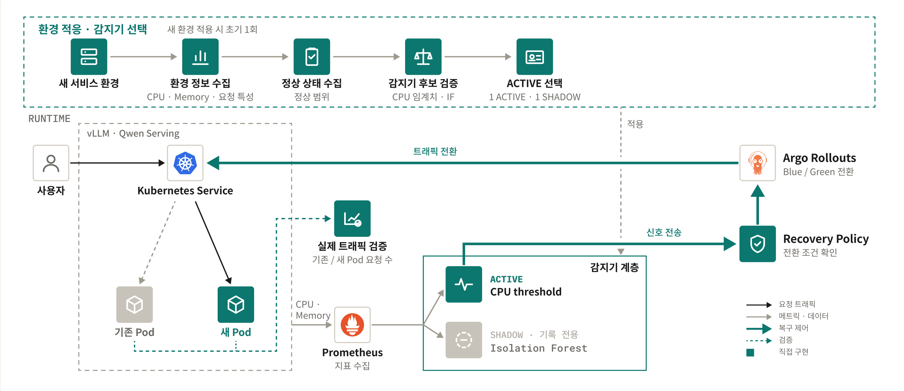
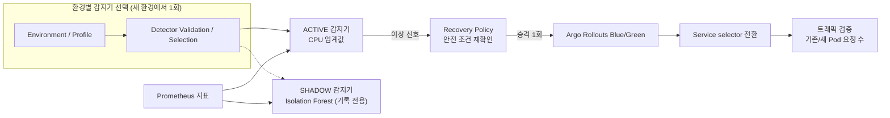

<div align="center">

# LLM 서빙 성능 저하 대응을 위한 Kubernetes 자동 복구 시스템

**운영 지표의 이상 신호를 감지하면, 안전 조건을 다시 확인한 뒤 Blue/Green 전환을 실행하고<br>기존/새 Pod의 실제 요청 수로 트래픽 이동까지 확인하는 자동 복구 시스템**


[](docs/final/PHASE2-FINAL-RESULT-20261012.md)
[](demo/README.md)
[](experiments/README.md)

<sub>2026 숭실대학교 전자정보공학부 IT융합전공 졸업작품 · 지도교수 김영한 교수님 · 작성자 박소정</sub>

</div>

---

## 왜 필요한가

LLM 서빙 Pod는 죽지 않고 **느려지기만** 하는 경우가 많다(예: CPU 압박). Kubernetes 기본 self-healing(재시작·재생성)은 Pod·컨테이너 상태와 probe 결과를 기준으로 동작하므로, Pod는 살아 있는데 응답만 느린 상태는 그대로 이어질 수 있다. 이 프로젝트는 그 구간을 운영 지표로 감지하고, 미리 준비해 둔 새 Pod로 트래픽을 옮겨 서비스 품질 저하 시간을 줄인다.

## 아키텍처

<p align="center">
  
</p>

<details>
<summary>텍스트 다이어그램</summary>



</details>

감지기는 환경에 맞게 바꿀 수 있는 부품이고, Recovery Policy 이후의 복구 경로는 감지기 종류와 상관없이 같다. 현재 환경(vLLM CPU 서빙, Qwen2.5-0.5B)에서는 사전등록한 선택 규칙에 따라 **CPU 임계값이 ACTIVE**, **c3-A Isolation Forest가 SHADOW**다. SHADOW는 같은 지표를 보고 기록만 하며 복구를 요청할 권한이 없다.

## 이 시스템이 실제로 하는 일

1. **Detect** - 15초마다 최근 60초의 CPU·메모리 지표로 특징을 만들고, ACTIVE 감지기가 3회 연속 이상이면 신호를 보낸다.
2. **Guard** - Recovery Policy가 신호를 받은 시점의 상태(Rollout, active/preview 버전, Pod UID·Ready·재시작 수)와 지금 상태가 같은지 다시 확인한다. 하나라도 다르면 전환하지 않는다. 중복 신호·오래된 신호는 거부하고, 실행당 조치는 1회로 제한한다.
3. **Promote** - Argo Rollouts로 대기 중인 새 Pod(preview)를 승격해 Service selector를 새 버전으로 바꾼다.
4. **Verify** - 승격 API의 성공 응답만 믿지 않고, 전환 뒤 60초 동안 기존/새 Pod의 `:8000/metrics` 요청 카운터를 직접 읽어 트래픽이 새 Pod로 옮겨졌는지 판정한다.

## 핵심 결과

| 확인한 것 | 결과 |
|---|---|
| 실제 전환이 서비스 품질 저하 시간을 줄이는가 (같은 압박에서 기록만 한 경우 vs 실제 전환) | **사전 고정된 공식 비교 5쌍에서 5/5 같은 방향**(전환한 쪽은 모두 0 s), **사전등록 추가 반복 3쌍에서도 3/3 같은 방향** |
| 전환이 실제 트래픽 이동으로 이어졌는가 | 실제 전환 **8회 모두** 새 Pod 요청 +60~61, 기존 Pod +0. 승격 요청 → Service selector 변경 확인 **중앙값 1.37 s**(범위 0.86–7.87 s) |
| 정상 운전에서 불필요한 신호 | 정상 범위를 넓혀 다시 학습한 IF(c3-A)가 블라인드 정상 4세션에서 불필요 신호 **14 → 1** (92.9% 감소). 압박 탐지 성능에 대한 결과는 아니다 |
| 현재 환경에 맞는 감지기 선택 | 사전등록 압박 Gate(주입 후 정해진 시간 안 3회 연속 신호): **CPU 임계값 5/5, IF 0/5** → CPU 임계값을 ACTIVE로 선택 |
| 선택된 감지기로 실제 복구 | **3/3 성공** - 매회 신호 1 · 승격 1 · 트래픽 검증 통과, SHADOW 권한 누수 없음 |

세부 수치·정의·해석 범위: [Phase 2 최종 결과](docs/final/PHASE2-FINAL-RESULT-20261012.md) · [Phase 1 정리](docs/final/FINAL-RESEARCH-SYNTHESIS-20261011.md) · [A/B 추가 반복](docs/final/PHASE1-AB-ADDITIONAL-REPLICATION-20261013.md) · [전환 시간](docs/final/AB-TRAFFIC-SWITCH-TIMING-20261015.md)

CPU 임계값이 선택된 것은 **이 CPU 압박 환경**의 결과이며, CPU 임계값이 Isolation Forest보다 일반적으로 낫다는 뜻이 아니다.

## 시연

```
정상 서비스 → CPU 압박 → ACTIVE 감지기 3회 연속 → Recovery Policy 안전 조건 확인
→ Argo 승격 → Service 전환 → 기존/새 Pod 요청 수로 이동 확인
```

[demo/](demo/README.md)의 `prepare-demo.ps1` → `start-pressure.ps1` → `cleanup-demo.ps1`로 실행한다. 시연은 demo-only(`counted=false`)이며 공식 실험 결과와 구분한다. 절차: [docs/demo/PHASE2-DEMO-RUNBOOK-20261012.md](docs/demo/PHASE2-DEMO-RUNBOOK-20261012.md)

## 저장소 안내 - 어디를 보면 되나

| 보고 싶은 것 | 위치 |
|---|---|
| 감지기(ACTIVE/SHADOW, 특징 계산) | [anomaly-detection/](anomaly-detection/README.md), 선택·동시 실행 [experiments/phase2_detector_selection/](experiments/phase2_detector_selection/) |
| 복구 정책(현재 최종 구현) | [recovery-policy/](recovery-policy/README.md) - `guarded_*.py`, `main_guarded.py` |
| 배포 매니페스트(Rollout·Service·RBAC·ServiceMonitor) | [gitops/](gitops/README.md) |
| 발표 시연 | [demo/](demo/README.md), 시연 화면(읽기 전용, demo-only) [dashboard/](dashboard/README.md) |
| 최종 결과 문서 | [docs/final/](docs/README.md) |
| 실험 실행기·근거 파일 | [experiments/](experiments/README.md) |
| 사전등록·계약·freeze (frozen / historical) | [docs/design/](docs/design/) |
| 부하·압박 생성기 | [chaos/](chaos/README.md) |
| 초기 정책의 결정 기록 (historical) | [audit-log/](audit-log/README.md) |

## 핵심 구현 파일

| 파일 | 역할 |
|---|---|
| [recovery-policy/main_guarded.py](recovery-policy/main_guarded.py) | Recovery Policy 서버 - 신호 수신 `/signal/v2`, 관리 API |
| [recovery-policy/guarded_policy.py](recovery-policy/guarded_policy.py) | 안전 조건 판단 - `GuardConfig`, `check_target`, `GuardedPolicy`, `_act_locked`(승격 직전 재확인) |
| [recovery-policy/guarded_k8s.py](recovery-policy/guarded_k8s.py) | 승격·검증 - `promote_once`, `verify_switch`, `evaluate_new_pod_traffic`, `ServiceChecker`, `pod_metrics_counter_reader` |
| [experiments/phase2_detector_selection/p2_executor.py](experiments/phase2_detector_selection/p2_executor.py) | ACTIVE/SHADOW 감지기를 같은 평가 시점에 실행, ACTIVE만 신호 송신 |
| [experiments/phase2_detector_selection/selection.py](experiments/phase2_detector_selection/selection.py) | 사전등록 규칙으로 감지기 선택 |
| [anomaly-detection/bck_rules/rule-spec-v1.json](anomaly-detection/bck_rules/rule-spec-v1.json) | CPU 임계값 규칙 정의 |
| [experiments/results/phase2_selection/active-profile.json](experiments/results/phase2_selection/active-profile.json) | 현재 환경의 ACTIVE/SHADOW 지정 |
| [gitops/apps/vllm-serving/rollout.yaml](gitops/apps/vllm-serving/rollout.yaml) | vLLM Blue/Green Rollout |

`recovery-policy/`의 `main.py`·`policy.py`·`rollouts_client.py`·`git_client.py` 등은 **초기 버전**이며 최종 실험에 쓰지 않았다.

## 실험과 근거

이 저장소의 결과는 결과를 보기 전에 규칙(비교 지표, 반복 수, 중단 규칙, 선택 Gate)을 사전등록하고 고정한 실험에서 나왔다. 실험별 실행기와 근거 파일은 [experiments/README.md](experiments/README.md)의 "결과 → 근거 위치" 표에서 찾을 수 있다.

| 실험 | 한 줄 결과 |
|---|---|
| Phase 1 A/B | 공식 5쌍 5/5 + 사전등록 추가 3쌍 3/3 같은 방향. 8쌍 합산은 참고 관측이며 공식 결과로 부르지 않는다 |
| B/C/K | 초기 IF(c1)가 보정 CPU 임계값보다 낫다는 증거 없음. 기존 고정 임계값(2.7 core)은 5/5 늦고 피해가 컸다 |
| N1 정상 운전 | 초기 IF(c1)가 불필요 신호를 더 일찍 냄(정상 학습 범위가 좁음) |
| c3-A | 정상 범위 확장 재학습으로 정상 불필요 신호 14 → 1, 사전등록 판정 PROMISING |
| Axis 2 | LLM 지표 다변량 감지기 NO_GO - 현재 환경에서 LLM 지표가 거의 변하지 않음 |
| Phase 2 | 선택 CPU 5/5 · IF 0/5 → 선택된 감지기로 실제 복구 3/3, `PHASE2_ARCHITECTURE_VALIDATED` |

서비스 품질 판정 정의(응답 지연·성공률 기준): [docs/design/slo-definition.md](docs/design/slo-definition.md)

## 배운 점

- 단순 CPU 압박에서는 보정된 CPU 임계값이 충분히 강했다.
- Isolation Forest는 정상 데이터 범위에 민감했다. 정상 범위를 넓히자 정상 운전의 불필요 신호가 크게 줄었다.
- 효과의 핵심은 "검증된 전환"이었다 - 안전 조건 재확인과 실제 트래픽 확인까지 끝나야 복구로 본다.
- 감지기를 환경에 맞게 고르고 같은 복구 경로에 연결하는 구조가 이 환경에서 실제로 동작했다.

## 한계

- CPU 기반 소형 LLM(vLLM CPU, Qwen2.5-0.5B) **단일 환경**의 결과다. GPU·다른 모델·다른 저하 유형으로의 일반화는 검증하지 않았다.
- 환경이 바뀌면 같은 절차로 감지기를 **다시 검증·선택**해야 한다. 자동 benchmarking·여러 감지기 자동 학습은 구현하지 않았다.
- AI 감지기(Isolation Forest)가 CPU 임계값보다 낫다는 결과는 얻지 못했다.
- 표본이 작다(Phase 1 A/B 공식 5쌍, Phase 2 실제 복구 3회, c3-A 검증 4세션).
- **재현성 범위**: 실험 계약·freeze manifest(SHA256)·분석기·테스트는 저장소에 있지만 clone만으로 전부 재현할 수는 없다.
  - 대용량 원자료(`experiments/results/*`의 tick 기록·로그)는 저장소 밖에 보존하고, `model.pkl`·`scaler.pkl`은 커밋하지 않았다(메타데이터·해시만 커밋).
  - freeze 해시는 원래 작업 폴더 파일 바이트(CRLF/LF 혼재) 기준이라 새 checkout에서는 줄바꿈 차이로 해시가 다를 수 있다.
  - 일부 frozen 테스트는 공식 결과가 저장소에 추가되기 전 상태를 가정하므로, 지금 checkout에서는 실패할 수 있다(현재 구현의 regression이 아니라 전제 차이).
  - 최종 guarded 정책의 배포 매니페스트는 저장소에 포함돼 있지 않다(`gitops/apps/recovery-policy/`는 초기 정책용).

## 문서

**현재 문서** - [docs/README.md](docs/README.md)

| 목적 | 문서 |
|---|---|
| 최종 결과(선택·실제 복구·판정·caveat) | [docs/final/PHASE2-FINAL-RESULT-20261012.md](docs/final/PHASE2-FINAL-RESULT-20261012.md) |
| Phase 1 정리·무결성 감사·후속 방향 | [docs/final/FINAL-RESEARCH-SYNTHESIS-20261011.md](docs/final/FINAL-RESEARCH-SYNTHESIS-20261011.md) |
| 공식 실험 증거·주장 판정표 | [docs/final/FINAL-EVIDENCE-SUMMARY-20261010.md](docs/final/FINAL-EVIDENCE-SUMMARY-20261010.md) |
| A/B 추가 반복(ab06–ab08) | [docs/final/PHASE1-AB-ADDITIONAL-REPLICATION-20261013.md](docs/final/PHASE1-AB-ADDITIONAL-REPLICATION-20261013.md) |
| A/B 실제 전환 시간 | [docs/final/AB-TRAFFIC-SWITCH-TIMING-20261015.md](docs/final/AB-TRAFFIC-SWITCH-TIMING-20261015.md) |
| 발표 문구·예상 질문 (2026-10-10 기준, 일부 수치 superseded) | [docs/final/PRESENTATION-PACKAGE-20261010.md](docs/final/PRESENTATION-PACKAGE-20261010.md) |
| 시연 runbook | [docs/demo/PHASE2-DEMO-RUNBOOK-20261012.md](docs/demo/PHASE2-DEMO-RUNBOOK-20261012.md) |

**Historical / Frozen** (당시 기준 문서 - 현재 설계 설명이 아님)

| 내용 | 위치 |
|---|---|
| 실험 계약·freeze manifest·중간 설계 | [docs/design/](docs/design/) |
| Phase 2 사전등록 rev 6 | [docs/design/PHASE2-DETECTOR-SELECTION-PREREG-v1-rev6.md](docs/design/PHASE2-DETECTOR-SELECTION-PREREG-v1-rev6.md) |
| Phase 2 실행기·implementation freeze r2·Stage 1 runbook | [experiments/phase2_detector_selection/](experiments/phase2_detector_selection/) |
| c3-A 사전등록·수집 runbook | [experiments/results/c3_normal_coverage_prereg_20261010/](experiments/results/c3_normal_coverage_prereg_20261010/) |
| 초기 제안서·대체된 요약 | [docs/history/](docs/history/) |

Phase 1 최종 연구 상태는 tag `phase1-final-20261011`에 있다. 초기 계획 README만 있던 `cluster/`, `monitoring/`, `finops/`, `operator/`, `pvc-backup/`와 참조되지 않는 중간 기록 일부는 2026-10-14 정리에서 master에서 뺐다(tag `phase1-final-20261011`·branch `research-snapshot-20261011`에 남아 있음).
